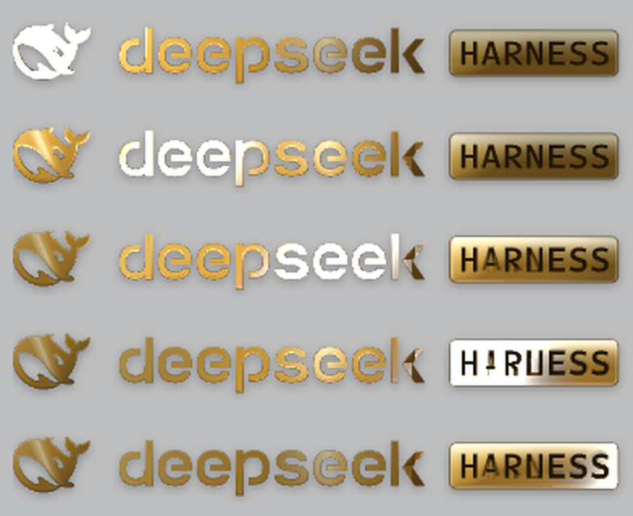

# dsh-logo-golden

A polished-gold rendition of the DeepSeek Harness sidebar brand lockup — the whale
mark, the `deepseek` wordmark and the HARNESS plate — drawn from the original
vectors, with a diagonal metal sweep that crosses the whole lockup every three
seconds.



This repository is the standalone distribution of the plugin
`@linxin666/dsh-client-ui-brand-gold`. It carries the full source, the test
suite and the build preset it needs, so `pnpm install && pnpm build` works in a
fresh clone with nothing else checked out.

## What it does

- **The brand, in gold.** The whale silhouette, every wordmark stroke and the
  HARNESS plate are the original paths. The material is layered inside them: a
  warm ramp with the key light upper left, a counter-light from the lower right,
  a contact shadow, a softbox reflection and an inner bevel. Nothing grows the
  outline, every layer is clipped to the original geometry, and the HARNESS
  lettering stays dark.
- **A sweep, not a flash.** One diagonal beam travels the whole lockup at once,
  leaning 25 degrees off vertical, with a 0.55 W wide gold band and a narrow
  champagne core. The deformation (1.08x local magnification, 0.8 px lift) moves
  the same material the light moves over, and it returns to the identity mapping
  at rest.
- **Every metal surface, including the dark ones.** A geometric mask built from
  the original vectors decides what counts as metal. The whale's fill, every
  solid stroke and the plate are lit; the plate lettering, the counters, the
  gaps between strokes and the background never are. A shadowed gold stroke at
  8% luminance is lit; the dark HARNESS ink at the same luminance is not.
- **Three-second cadence.** A cycle starts every 3000 ms: 250 ms entry, 2200 ms
  across the metal, 250 ms exit, 300 ms at rest. The start times sit on an
  absolute grid, so a slow frame cannot drift them and a missed cycle is skipped
  rather than replayed.
- **The cadence survives a busy page.** Scrolling or resizing re-places the
  overlay instead of re-uploading it, and a pending timer whose grid has not
  moved is never re-armed, so a streaming session that scrolls continuously
  cannot delay the next sweep.
- **Extended range, honestly reported.** The canvas asks for
  `rgba16float` with `toneMapping: 'extended'` behind transparency and targets a
  1600 nit short-time peak at the core against the display's reference white. A
  value read back offscreen proves the *shader* produced over-unity light; the
  diagnostic never claims a screen measurement it did not take.
- **A fallback that is still the brand.** Without WebGPU, without the popover
  API, or under `prefers-reduced-motion: reduce`, the static gold lockup stands
  alone — same vectors, same geometry, no motion.

## Install

The plugin mounts as a Cordis bundle row. In a DSH profile:

```sh
dsh plugin --profile desktop add @linxin666/dsh-client-ui-brand-gold
```

or add the row by hand to the profile's `cordis.patch.yml`:

```yaml
- insert:
    - id: ui-brand-gold
      name: "@linxin666/dsh-client-ui-brand-gold"
```

The row id must not collide with an official row (the loader keeps one winner per
id and does not warn), and `name` must be exactly the package name: the client
module loader attaches the browser half only to the row whose specifier matches.

## Build and test

```sh
pnpm install
pnpm test        # 116 unit tests
pnpm typecheck
pnpm build       # tsdown bundle + tsc declarations into lib/
```

`build/tsdown.client.ts` is the shared client-bundle preset, vendored here so the
repository builds on its own; it is the same file the dsh-web monorepo uses for
every plugin.

## How the sweep works

```
sweep.ts       ← the dials: period, stages, widths, gains, peak
trajectory.ts  ← one monotone curve through the four stage boundaries
timeline.ts    ← the absolute cycle grid, one timer, one animation loop
layout.ts      ← rendered boxes → one canvas; the band's travel
beam.ts        ← the profile: FWHM, tilt, finite support, the warp
geometry-mask.ts ← the original vectors → which pixels are metal
surface.ts     ← eligibility (mask) vs shading (luminance, albedo floor)
raster.ts      ← the live SVG, serialized with its computed paints
material.ts    ← the composite the shader samples
renderer.ts    ← WebGPU: mask, inverse warp, light, extended output
overlay.ts     ← the controller that owns all of the above
```

Everything the animation depends on is a dial in `src/client/sweep.ts`; the
shader mirrors the CPU arithmetic term for term, and the tests assert the
**delivered** result (band width, core width, peak luminance, which pixels lit
up) rather than the input values.

Two rules keep the cadence honest, and both are covered by
`tests/cadence.spec.ts`:

1. a pending timer is never cleared while the grid is unchanged — its target is
   an absolute grid point, not "in N milliseconds from now";
2. the cycle that runs is the grid point the timer was armed for, as long as its
   window is still open, so a callback that arrives a few milliseconds early or
   late cannot be mistaken for a missed cycle.

## Package layout

| Path | What it is |
|---|---|
| `src/index.ts` | host half: registers the bundle, carries no behavior |
| `src/client/` | browser half: the components, the controller, the shader |
| `tests/` | vitest suites, jsdom where the DOM is involved |
| `build/` | the vendored client-bundle preset |
| `locale/` | plugin list metadata (en / zh) |
| `cordis.patch.yml` | the bundle row |

## License

Apache-2.0. See [LICENSE](LICENSE).
