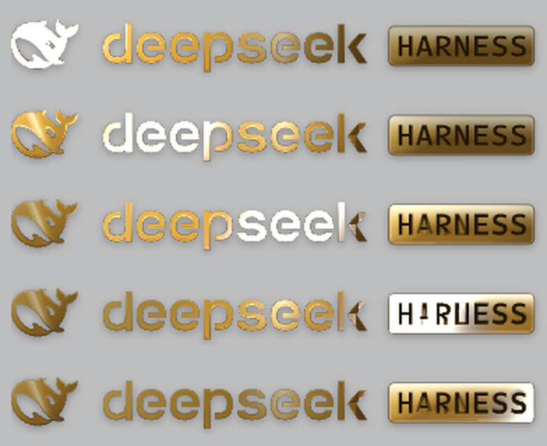
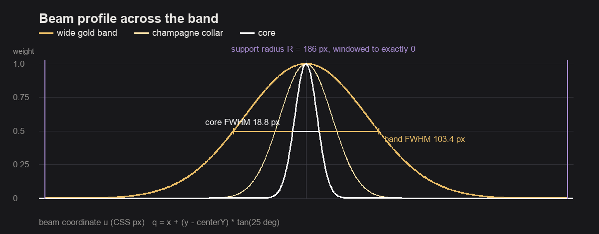
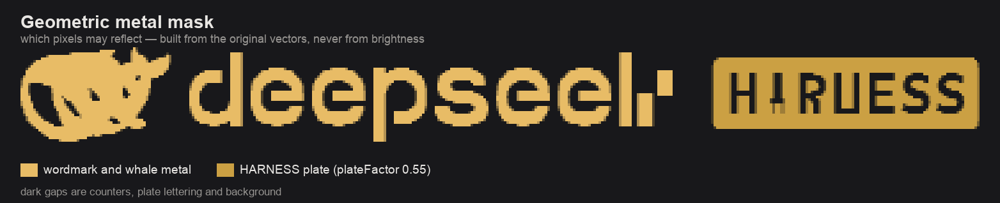
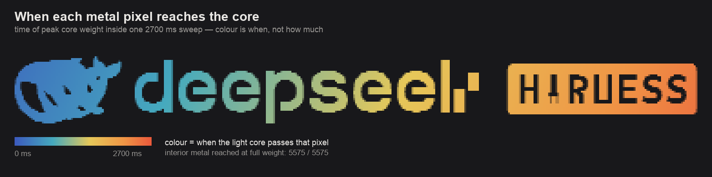
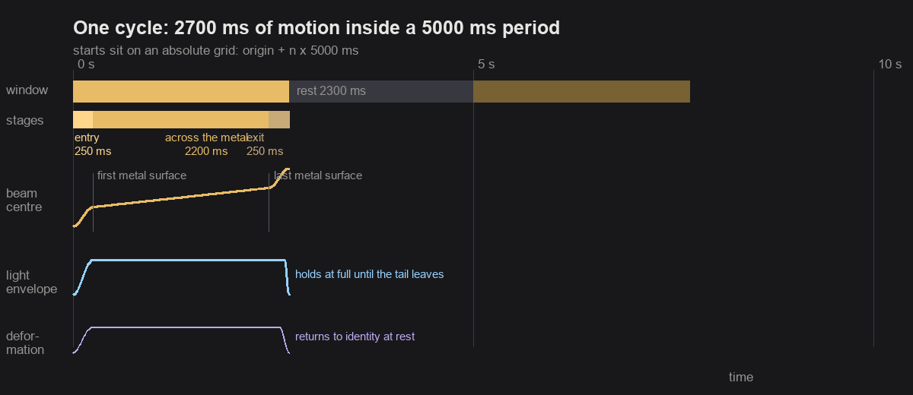

# dsh-logo-golden

DeepSeek Harness 侧栏品牌组合的抛光黄金版本 —— 鲸鱼图标、`deepseek` 字标与 HARNESS
铭牌，全部用原始矢量绘制，并有一道斜向金属光带每五秒完整掠过整个组合。



<sub>一个周期中的五帧，取自真实 DSH 宿主：光带从鲸鱼进入，穿过字标，抵达 HARNESS
铭牌，随后组合回到静止的金色。</sub>

本仓库是插件 `@linxin666/dsh-client-ui-brand-gold` 的独立分发版：完整源码、测试与构建
所需预设都在这里，新克隆下 `pnpm install && pnpm build` 即可工作，不依赖其它检出。

## 它做了什么

- **黄金品牌。** 鲸鱼轮廓、每一个字标笔画与 HARNESS 铭牌都沿用原始路径；材质分层绘制在
  轮廓内部：主光在左上的暖金渐变、右下的反光、接触阴影、柔光箱反射与内嵌倒角。没有任何
  一层撑大轮廓，每层都裁剪到原始几何，HARNESS 深色铭文保持深色。
- **是扫光，不是整体闪光。** 一道相对竖直倾斜 25 度的斜向光带同时穿过整个组合，宽金亮带
  为 0.55 倍组合宽度，中间是窄香槟光芯；局部形变（1.08 倍放大、0.8 px 上浮）与光带移动
  的是同一份材质，静止时精确回到恒等映射。

  

  <sub>出厂 188 px 组合上的实际分布，用与着色器同一套算术绘制：半高全宽 103.4 px 的宽亮带、
  18.8 px 的光芯，以及在 186 px 处精确归零的有限支撑半径——正是它让“光带已经离开”成为可
  证明的结论，而不是一次淡出。</sub>
- **每一块金属都受光，包括暗金。** 由原始矢量光栅出的几何遮罩决定“是不是金属”：鲸鱼填充
  区、每个实心笔画与铭牌受光；铭牌深色铭文、镂空、字符之间的空隙与背景永不受光。亮度 8%
  的暗金笔画受光，同样亮度的深色铭文不受光。

  

  <sub>着色器上传的遮罩，直接来自出厂矢量：浅金是字标与鲸鱼金属，较深的是铭牌，深色缺口
  是镂空、铭牌铭文与背景。这个判断里没有任何亮度阈值参与。</sub>

  

  <sub>整个周期实测，按“何时”而非“多少”着色：鲸鱼最先，字标居中，铭牌最后——一条光带、
  一次行程。内部金属像素全部以满权重被扫到（DPR 2 下 5575 / 5575），只有抗锯齿轮廓保持
  部分受光——半覆盖的边缘本就该如此。</sub>
- **五秒节奏。** 每 5000 ms 开始一轮：入场 250 ms、遍历金属 2200 ms、退场 250 ms、静止
  2300 ms。开始时刻落在绝对栅格上，掉帧不会累积漂移，错过的周期直接跳过而不补播。

  

  <sub>控制器实际运行的四条轨道：可见窗口与静止时间的对比、三个阶段、光束中心从第一块
  到最末一块金属表面的行程，以及随它一起移动的两个幅度。亮度包络在尾部离开金属之前一直
  保持满幅，因此没有任何表面被淡入淡出削弱。</sub>
- **忙碌页面也保持节奏。** 滚动与缩放只重定位叠加层，不重新上传；栅格未变时挂起的定时器
  绝不重设，因此持续滚动的流式会话不会推迟下一轮扫光。
- **扩展动态范围，如实报告。** 画布请求 `rgba16float` 与 `toneMapping: 'extended'`，
  在透明背景下以显示参考白为基准瞄准光芯 1600 nit 短时峰值。离屏读回只能证明**着色器**
  输出了超过 1.0 的值；诊断不会把推算值说成屏幕实测。
- **回退后仍是同一个品牌。** 没有 WebGPU、没有 popover API，或处于
  `prefers-reduced-motion: reduce` 时，保留静态黄金组合：同样的矢量、同样的几何、没有动画。

## 安装

插件以 Cordis bundle 行的形式挂载。在 DSH profile 中：

```sh
dsh plugin --profile desktop add @linxin666/dsh-client-ui-brand-gold
```

或手工在 profile 的 `cordis.patch.yml` 中加入：

```yaml
- insert:
    - id: ui-brand-gold
      name: "@linxin666/dsh-client-ui-brand-gold"
```

行 id 不得与官方行冲突（loader 对同一 id 只保留一个且不报错），`name` 必须与包名完全
一致：client 模块加载器只把浏览器半区挂到说明符等于包名的那一行上。

## 构建与测试

```sh
pnpm install
pnpm test        # 116 个单元测试
pnpm typecheck
pnpm build       # tsdown 打捆 + tsc 生成声明到 lib/
```

`build/tsdown.client.ts` 是共享的客户端打捆预设，为让仓库独立可构建而内置；它与 dsh-web
monorepo 中所有插件用的是同一份文件。

## 扫光是怎么工作的

```
sweep.ts       ← 全部参数：周期、阶段、宽度、增益、峰值
trajectory.ts  ← 过四个阶段边界的一条单调曲线
timeline.ts    ← 绝对周期栅格、一个定时器、一个动画循环
layout.ts      ← 渲染盒 → 同一块画布；整条光带的行程
beam.ts        ← 光分布：FWHM、倾角、有限支撑、形变
geometry-mask.ts ← 原始矢量 → 哪些像素是金属
surface.ts     ← 资格（遮罩）与着色（亮度、反照率下限）分开
raster.ts      ← 实时 SVG，内联计算后的绘制属性
material.ts    ← 着色器采样的合成材质
renderer.ts    ← WebGPU：遮罩、逆向形变、配光、扩展输出
overlay.ts     ← 拥有以上全部资源的控制器
```

动画依赖的每个数字都是 `src/client/sweep.ts` 里的参数；着色器逐项复刻 CPU 侧的算术，
测试断言的是**最终交付**的结果（亮带宽度、光芯宽度、峰值亮度、哪些像素真的亮了），
而不是输入参数本身。

两条规则保证节奏不漂移，均由 `tests/cadence.spec.ts` 覆盖：

1. 栅格未变时挂起的定时器绝不清除 —— 它的目标是绝对栅格点，不是“N 毫秒之后”；
2. 实际运行的是定时器当初武装的那个栅格点，只要窗口还开着，回调早到或晚到几毫秒都不会被
   误判成“错过一轮”。

## 包结构

| 路径 | 内容 |
|---|---|
| `src/index.ts` | host 半区：注册 bundle，不含行为 |
| `src/client/` | 浏览器半区：组件、控制器、着色器 |
| `tests/` | vitest 测试，涉及 DOM 的用 jsdom |
| `build/` | 内置的客户端打捆预设 |
| `locale/` | 插件列表元数据（en / zh） |
| `cordis.patch.yml` | bundle 行 |

## 许可

Apache-2.0，见 [LICENSE](LICENSE)。